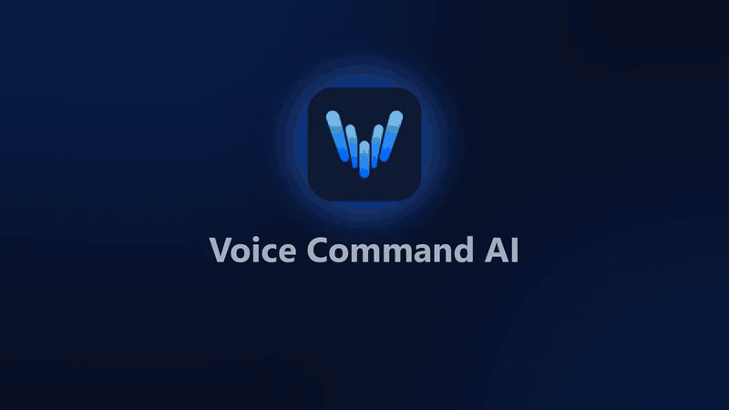

<p align="center">
  <picture>
    <source media="(prefers-color-scheme: dark)" srcset="docs/brand/logo/02_lockups/horizontal/VCA_logo_horizontal_dark-transparent.svg">
    
  </picture>
</p>

<p align="center"><strong>Your voice. Every agent. One command center.</strong></p>

# Voice Command AI

**Control every AI coding agent on your machine from your phone, with your voice.**

<p align="center">
  <a href="https://youtu.be/y1nxSgDrQi8"></a>
  <br>
  <sub>▶ Click the animation to watch the full 2-minute walkthrough: <a href="https://youtu.be/y1nxSgDrQi8">https://youtu.be/y1nxSgDrQi8</a></sub>
</p>

Voice Command AI (VCA) is an open-source, cross-platform tool. It lets you watch, command and orchestrate AI coding agents running on your development machine. Supported agents include Claude Code, OpenAI Codex, Gemini CLI, Google Antigravity, Grok and more. You can reach them from anywhere, without fighting for keyboard focus and without letting runaway builds bring your machine down.

> **Status:** Version 0.1.0, the first public release (November 11, 2026). The desktop app for Windows and macOS is on [GitHub Releases](https://github.com/JinsongRoh/Voice-Command-AI/releases/tag/v0.1.0) and updates itself; the iPhone and Android apps are in review at the App Store and Google Play. See [Download](#download), the [user guide](docs/user-guide.md) and the [changelog](CHANGELOG.md).

---

## Why

Modern development often means running many agent sessions in parallel. Each session spawns its own sub-agents, compilers, test runners and helper windows. On a single workstation this quickly causes three problems:

- **Focus theft.** New windows constantly steal focus, so prompts and keystrokes land in the wrong terminal.
- **Resource exhaustion.** Agents launch builds and tests with no awareness of each other until CPU and memory are saturated and the machine stalls.
- **Navigation overhead.** Existing remote-control apps make you drill into one project, go back, and drill into another for every command.

VCA fixes this by putting a lightweight server on your machine. That server owns every agent session and exposes the sessions to a mobile app as a simple deck of cards.

## Download

| Platform | Get it | Notes |
|---|---|---|
| Windows 10/11 (x64) | [Installer (.exe)](https://github.com/JinsongRoh/Voice-Command-AI/releases/latest/download/Voice.Command.AI_0.1.0_x64-setup.exe) | Signed by MetaVu Co., Ltd. Includes the server. |
| macOS (Apple silicon) | [Disk image (.dmg)](https://github.com/JinsongRoh/Voice-Command-AI/releases/latest/download/Voice.Command.AI_0.1.0_aarch64.dmg) | Developer ID signed and notarized. Includes the server. |
| macOS (Intel) | [Disk image (.dmg)](https://github.com/JinsongRoh/Voice-Command-AI/releases/latest/download/Voice.Command.AI_0.1.0_x64.dmg) | Developer ID signed and notarized. Includes the server. |
| Linux | Coming in a later version. Until then, [build from source](docs/user-guide.md#build-from-source). | The server also runs on Linux when built from source. |
| iPhone, iPad | App Store: *in review, coming soon* | iOS 15 or later. Includes a demo mode. |
| Android | Google Play: *in review, coming soon* | Android 8.0 or later. Includes a demo mode. |

All files, release notes and update signatures are on the [v0.1.0 release page](https://github.com/JinsongRoh/Voice-Command-AI/releases/tag/v0.1.0).

Install the desktop app on the PC where your agents run, then pair your phone: one QR code from **Settings › Connection & security › Connect a phone** pairs it (and registers it for remote access when you use DNSPilot). The [user guide](docs/user-guide.md#2-install-vca) has the steps for each platform, and how to build everything from source. Before you open VCA to other devices, read [Security setup](docs/security-setup.md); the [privacy policy](docs/privacy.md) explains what stays on your machine and what leaves it.

## Highlights

- **Session cards.** Every running agent session on your machine is listed as a live card showing project, agent, status, alerts and how many sub-agents it is running. Bring in AI CLI sessions that are already open, or pick or create a project folder and start a new session from your phone. **Remove from VCA** takes any session off the list.
- **Voice first.** Pick a card, speak, review the transcript, send. Mixed-language speech (for example English mixed with Japanese, Spanish or Korean) is supported. A developer-vocabulary engine and your own list of commonly misheard words improve recognition, and a recording is kept for **Retry** when the network is weak.
- **Hands-free with "Voco".** Say "Voco", dictate, and end with "over"; you have 3 seconds to cancel. Off by default.
- **No focus required.** Commands are delivered straight to the target session through a virtual terminal or the agent's native channel, never through simulated keystrokes.
- **Live view.** Stream any session in real time as a readable chat view or the raw terminal, and keep the conversation going from there.
- **Alerts you can act on.** An Alerts menu lists every session waiting for a decision or input; answer with one tap, or answer an agent's multi-question form in one go. Optional agent hooks for Claude Code and Codex, installed from the desktop app, make approval alerts exact.
- **Spoken alerts with your own TTS.** Hear alerts, a status briefing and (opt-in) result summaries through the device voice or your own OpenAI-compatible TTS engine.
- **A to-do list from your agents.** Requests an agent needs you for (sign in, approve, run an admin command) are collected in one list. Check them off and send the result back; commands never run for you.
- **Command Center (the conductor).** An opt-in AI session (Claude Code, Codex CLI, Gemini CLI or a built-in loop with your own LLM) that oversees your other sessions. Every message it wants to send waits for your Allow or Deny, and it never answers permission prompts. See [The conductor](docs/conductor.md).
- **Windows back after a restart.** After a reboot or a power cut, VCA reopens your AI CLI windows in the same place and the same conversation.
- **Screen layout.** Arrange open terminal windows in a grid on each monitor, and save layouts to apply again.
- **Cloud agents.** Start and follow sessions at Jules, Cursor, Devin, GitHub Copilot, Claude managed agents and Codex cloud with your own accounts.
- **Resource broker.** CPU, memory, disk and network are monitored per session. Heavy jobs are admitted, queued, throttled or paused, automatically or by your own policies.
- **Made for the phone.** Swipe through sessions, attach photos and files, open a locked-down remote shell (admin devices only, with an authenticator code), and pick a light, dark or black theme. **Try the demo** on the first screen explores the app with sample sessions before you have a PC set up. The app speaks English, Korean, Japanese and Spanish.
- **Multiple machines.** Pair your home, office and server machines with one app.
- **Secure remote access.** Device pairing via QR code, TOTP two-factor authentication, short-lived tokens, end-to-end encryption, audit log and a kill switch. The apps open locked and unlock with Windows Hello, Touch ID, Face ID or fingerprint.
- **Private by design.** No VCA account, no VCA cloud, no analytics. Self-hosted use sends MetaVu no personal data; optional DNSPilot is the only VCA-team service that receives any. The diagnostic log is off by default and never uploaded.
- **Your choice of connectivity.** Pluggable providers: Tailscale, Cloudflare Tunnel, direct LAN, DNSPilot (app-mode tunnel: only the VCA app's pinned key gets in, no open ports), or bring your own.
- **Pluggable speech-to-text.** Use any OpenAI-compatible server (for example a self-hosted Whisper server), OpenAI or Google Cloud; live dictation streams as you speak.
- **Your own engines, no company servers.** VCA ships no speech servers and no model weights. Set up your own speech-to-text, correction LLM and text-to-speech engines (local or your own cloud account) in the desktop app, with presets and a one-click test: see [Your own speech engines](docs/speech-engines.md) and the [reference TTS server](tools/tts-server/README.md).

## Architecture at a glance

```
┌────────────────┐     encrypted tunnel      ┌──────────────────────────────┐
│  VCA Mobile    │◄─────────────────────────►│  VCA Server (your machine)   │
│  (Tauri 2)     │   (DNSPilot / Tailscale  │  ├─ Session manager (PTY)    │
│  cards · voice │    / Cloudflare / LAN)    │  ├─ Agent adapters           │
│  live view     │                           │  ├─ Resource broker          │
└────────────────┘                           │  ├─ Speech pipeline          │
                                             │  └─ Auth · audit · API       │
                                             └──────────────┬───────────────┘
                                                            │
                                     Claude Code · Codex · Gemini CLI · Antigravity · Grok · …
```

The core is written in Rust. The desktop and mobile apps are built with [Tauri 2](https://tauri.app) and run on Windows, macOS, Linux, iOS and Android.

## Documentation

**Using VCA**

- [Walkthrough video](https://youtu.be/y1nxSgDrQi8) (2 minutes; [Korean](https://youtu.be/I3vdZhCmwQg))
- [User guide](docs/user-guide.md): install, pair, talk to your agents, reach your PC
- [Your own speech engines](docs/speech-engines.md): speech-to-text, correction LLM and text-to-speech
- [Your own Whisper server](docs/whisper-server.md): a self-hosted speech-to-text server
- [TTS engine benchmark](docs/tts-benchmark.md): seven open-source TTS engines compared
- [The conductor](docs/conductor.md): one AI that oversees your other sessions
- [Security setup](docs/security-setup.md): two-factor sign-in, local verification, recovery
- [Privacy policy](docs/privacy.md): what stays on your machine and what leaves it
- [Support](https://vca.metavu.io/support.html): where to get help

**Project**

- [Architecture](docs/architecture.md)
- [Releasing](docs/releasing.md): builds, signing and in-app updates
- [Security policy](SECURITY.md)
- [Contributing](CONTRIBUTING.md) and [code of conduct](CODE_OF_CONDUCT.md)
- [Changelog](CHANGELOG.md)
- [Open-source credits](docs/open-source.md) and [third-party notices](THIRD_PARTY_NOTICES.md)
- [Brand definition](docs/brand/brand-definition.md) and [logo files](docs/brand/logo/README.md)
- [Historical planning documents](docs/history/README.md): requirements, development plan, M0 report

## Supporting the project

Voice Command AI is free and open source, and every feature works without paying anyone. If you want to support its development, you can:

- **Consider [DNSPilot](https://dnspilot.kr) for connectivity** (console: [dns.dnspilot.kr](https://dns.dnspilot.kr)): choose "Connect DNSPilot" in the app (see the [user guide](docs/user-guide.md), section 5). DNSPilot is developed by the same team that maintains VCA; once its paid plans open, subscriptions will help fund VCA's development. It is entirely optional: Tailscale, Cloudflare Tunnel, direct LAN and custom providers are supported on equal footing.
- **Contribute** code, agent adapters, translations or vocabulary for your language.
- **Star the repository** and share it with other developers.

## License

[MIT](LICENSE). Voice Command AI includes open-source components under their own licenses: see the [open-source credits](docs/open-source.md) and the full [third-party notices](THIRD_PARTY_NOTICES.md) (regenerate with `python tools/licenses/generate.py`).
